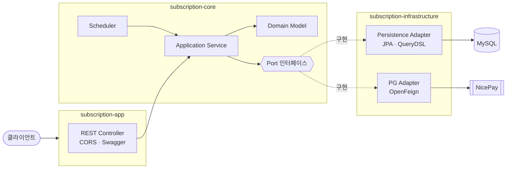
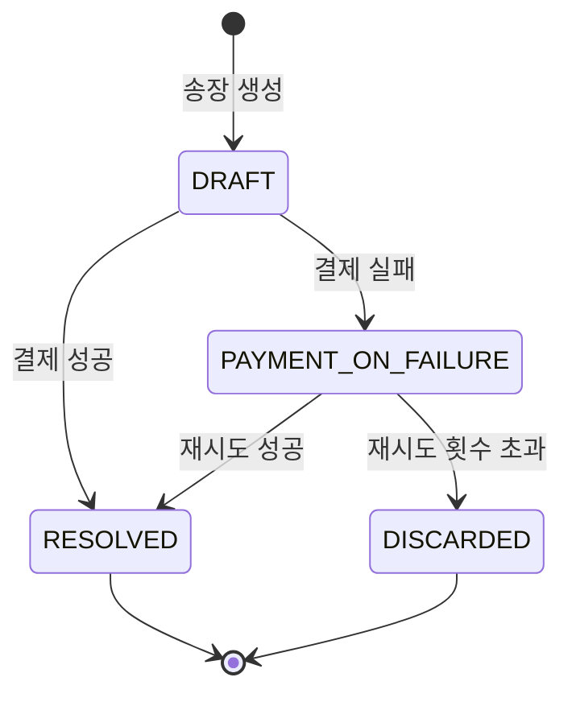

# subscription-demo

구독형 서비스의 **정기결제 백엔드** 예제입니다. 상품·요금제 관리, 구독 생명주기, 송장(Invoice) 기반 정기결제, 환불을 다루고, PG는 나이스페이먼츠 빌링키 방식으로 연동합니다.

## 주요 기능

- **상품(Product) · 요금제(Plan)**: 요금제의 이름·등급·가격·결제 주기가 바뀌면 버전이 올라갑니다.
- **구독 생명주기**: 시작, 해지 요청·취소, 활성/비활성 전환
- **선불(PREPAID) / 후불(POSTPAID)** 정산 전략, 결제 기준일을 지정한 **일할 계산**
- **정기결제 스케줄러**: 자정에 송장 생성 → 17시에 결제, 실패한 송장은 14일 이내 재시도
- **빌링키** 등록·삭제, 결제, 전체·부분 환불
- **멀티 테넌트**: 모든 API가 `enterpriseId` 헤더를 받고, 식별자는 `(enterpriseId, id)` 복합키

## 기술 스택

Kotlin 1.9.25 · JDK 21 · Spring Boot 3.5.11 · Spring Data JPA (Hibernate) · QueryDSL 5.1.0 (kapt) · Spring Cloud OpenFeign · MySQL 8 · springdoc-openapi (Swagger UI) · ULID

## 아키텍처

포트 & 어댑터 구조의 멀티 모듈입니다. 도메인과 유스케이스(`core`)는 DB나 PG를 모르고, 인터페이스(포트)만 정의합니다. 구현은 `infrastructure`가 맡습니다.

| 모듈 | 역할 |
|---|---|
| `subscription-core` | 도메인 모델(`Subscription`, `SubscriptionInvoice`, `Payment` …), 유스케이스 서비스, 포트, 스케줄러 |
| `subscription-infrastructure` | 포트 구현: JPA 엔티티·리포지토리(QueryDSL), 나이스페이먼츠 Feign 클라이언트, PG 어댑터 |
| `subscription-app` | REST 컨트롤러, CORS·Swagger 설정, 실행 가능한 `bootJar` |

## 도메인과 정기결제 흐름

### 상태

| 대상 | 상태 |
|---|---|
| 구독 `SubscriptionStatus` | `PENDING` · `ACTIVE` · `PAYMENT_ON_FAILURE` · `INACTIVE` · `TERMINATE_READY` · `TERMINATED` |
| 송장 `InvoiceStatus` | `DRAFT` · `RESOLVED` · `PAYMENT_ON_FAILURE` · `DISCARDED` |

### 스케줄러 (`SubscriptionScheduler`)

| 시각 | 작업 |
|---|---|
| 매일 00:00 | `ACTIVE` 구독 중 오늘이 결제일인 건의 송장(`DRAFT`)을 생성하고, 같은 구독의 송장이 또 생기지 않도록 잠금 |
| 매일 00:00 | 해지 요청(`TERMINATE_READY`)한 선불 구독을 결제일에 해지 완료 처리 |
| 매일 17:00 | 오늘 결제일인 `DRAFT` 송장 + 최근 14일 내 결제 실패 송장을 PG로 결제 |

결제 결과에 따라 송장과 구독이 함께 바뀝니다. 성공하면 송장 `RESOLVED`, 구독 `ACTIVE`, 다음 결제일 갱신, 송장 잠금 해제. 실패하면 송장의 재시도 횟수가 오르고 구독은 `PAYMENT_ON_FAILURE`가 되며, 요금제에 정한 재시도 횟수를 넘으면 구독이 `INACTIVE`로 바뀝니다.

## 기술적 설명

### 1. 포트 & 어댑터로 PG 교체 가능성 열어 두기
`BillingKeyPgPort`(core) → `BillingKeyPgAdapter`(infrastructure)가 `VanCompany`에 따라 PG 구현으로 분기합니다. 현재 구현된 PG는 나이스페이먼츠(`NICE_PAYMENTS`)뿐이고, 다른 PG는 어댑터에 분기를 추가하는 방식으로 붙일 수 있게 열어 두었습니다.

### 2. 요금제 스냅샷
구독을 만들 때 요금제를 `PlanSnapshot`(JSON 컬럼)으로 복사해 둡니다. 이후 요금제 가격이 바뀌어도 이미 가입한 구독의 청구 금액은 달라지지 않습니다. 구독 중 계약이 바뀌면 `nextSnapshot`에 담아 두었다가 **다음 결제가 성공한 시점에** 반영합니다.

### 3. 송장 중복 생성 방지
송장을 만들면 구독에 `isLockGeneratingInvoice`를 걸고, 결제에 성공하면 풉니다. 잠긴 구독으로는 `SubscriptionInvoice`가 생성되지 않습니다(`init`에서 검증). 스케줄러가 다시 돌거나 수동 실행으로 겹쳐도 같은 회차 송장이 두 번 생기지 않게 하려는 장치입니다.

### 4. 금액 계산
금액은 `BigDecimal`로 계산하고, 일할 계산은 소수 10자리까지 나눈 뒤 곱합니다. 마지막에 요금제의 `roundMode`(`HALF_UP` / `FLOOR` / `CEILING`)로 `Long`으로 변환합니다. 결제 회차는 `payVersion`으로 구독·송장·결제에 같이 기록합니다.

### 5. 복합키와 스케줄러 쿼리 인덱스
테넌트를 구분하려고 구독의 키를 `@EmbeddedId (enterprise_id, subscription_id)`로 두었습니다. 스케줄러가 "오늘 결제일인 `ACTIVE` 구독"을 찾으므로 `next_billing_date`를 `next_billing_at`과 별도 컬럼으로 두고 `(enterprise_id, next_billing_date, status)` 인덱스를 걸었습니다.

### 6. PG 연동
빌링키 발급·승인·취소 API를 OpenFeign으로 호출합니다. 빌링키 발급 시 카드 정보는 AES로 암호화하고 SHA-256 서명을 붙입니다. 나이스페이먼츠 응답이 `text/html` + EUC-KR로 오는 JSON이라 Feign 디코더를 따로 구성했습니다.

### 7. 기타
- 식별자는 ULID에 짧은 난수를 붙여 시간순 정렬이 가능합니다.
- JPA 배치 설정(`batch_size`, `rewriteBatchedStatements`, `default_batch_fetch_size`)과 `open-in-view: false`를 사용합니다.
- 테이블은 `ddl-auto: update`로 자동 생성됩니다. API 문서(Swagger UI)는 http://localhost:8080/kl-swagger-ui/index.html 입니다.

> 빌링키 등록·결제·환불처럼 PG를 호출하는 API는 나이스페이먼츠 가맹점 설정이 있어야 동작합니다. 그 외 API(상품·요금제·구독 조회 등)는 PG 없이 확인할 수 있습니다.

## API 개요

모든 API에 `enterpriseId` 헤더가 필요합니다. 전체 목록은 Swagger에서 확인할 수 있습니다.

| 경로 | 설명 |
|---|---|
| `/product` | 구독 상품 등록·수정·활성화·삭제·조회 |
| `/plan` | 요금제 등록·수정·활성화·삭제·조회 |
| `/subscription` | 구독 시작, 해지·해지 취소, 결제일 변경, 활성 전환, 조회. 스케줄러 작업을 수동 실행하는 API 포함 |
| `/invoice` | 송장 조회 |
| `/billing-key` | 빌링키 등록·삭제·조회 |
| `/payment` | 결제, 결제 취소(송장 기준 포함), 조회 |
| `/refund` | 환불 내역 조회 |

## 진행 상황

데모 단계의 프로젝트라 아래 항목이 남아 있습니다.

- 응답(`ResponseEntity`)과 에러 처리 정리
- 스케줄러·결제 실패 로그를 `println`에서 로거와 알림으로 교체
- 테스트 코드
